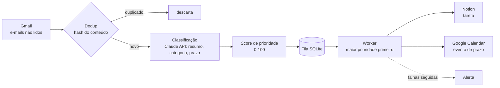

# Email Automation Assistant

Lê e-mails não lidos do Gmail, usa a API da Claude para extrair resumo, categoria e prazo, calcula uma prioridade e transforma cada e-mail em tarefa no Notion (com evento no Google Calendar quando há prazo). Cada e-mail vira uma tarefa numa fila persistente em SQLite. Se a Claude, o Notion ou o Calendar falharem, o e-mail não se perde: a ingestão é tentada de novo na próxima execução e o processamento é repetido sem refazer os passos que já deram certo.

## Fluxo



## Principais decisões técnicas

- **Fila em SQLite** (`db.py`): estados `pending → processing → done/failed`, ordenação por prioridade e depois por ordem de chegada. `message_id` é `UNIQUE`, então enfileirar duas vezes o mesmo e-mail é idempotente. Zero dependências externas.
- **Retry por tipo de erro** (`retry.py`): backoff exponencial com jitter, com política própria para rate limit (429, até 6 tentativas, respeita `Retry-After`), erro de servidor (5xx, 4 tentativas) e erro de conexão (5 tentativas). Erros como credencial inválida ou recurso inexistente não são repetidos. Há um decorator por API (Anthropic, Notion, Google). Na fila, uma tarefa que falha volta para `pending` até `MAX_ATTEMPTS`; depois vira `failed`.
- **Rate limit proativo** (`rate_limiter.py`): um token bucket por API (taxas configuráveis no `.env`), que espaça as chamadas antes de enviá-las. Reduz os 429 que o retry teria de tratar.
- **TTL da fila** (`Database.purge_expired`): a cada execução, tarefas concluídas com mais de 30 dias e tarefas esgotadas (`failed`) com mais de 90 dias são removidas. Pendentes e em processamento nunca expiram.
- **Ingestão isolada e atômica** (`Pipeline.ingest`): a falha de um e-mail é registrada no log (com `message_id`) e contada em `ingest_failed`, e os demais seguem. O hash do dedup é gravado na mesma transação que cria a tarefa (`Database.enqueue(content_hash=...)`), então um e-mail que falhou antes de entrar na fila não é tratado como duplicado na execução seguinte.
- **Classificação com exemplos e validação** (`claude_client.py`): o prompt traz 6 exemplos fictícios (reunião, prazo, promoção, ação sem prazo, newsletter, irrelevante) e a data de hoje, para resolver prazos relativos. A resposta é validada (chaves obrigatórias, tipos, categoria dentro da lista, `deadline` ISO com fuso).
- **Temperatura não é enviada**: o SDK usado (`anthropic` 1.15.0) não aceita o parâmetro `temperature` em `messages.create()`. A consistência do formato vem dos exemplos few-shot, da validação estrita e de 1 nova tentativa.
- **Faixa do `anthropic` restrita a `>=1.15,<2`**: 1.15.0 é a versão em que o código e os testes foram validados. O limite inferior evita uma versão antiga sem a API usada; o superior evita que uma major nova, com mudanças incompatíveis, quebre a instalação sem aviso. Ao subir de major, rode os testes e a chamada real antes de ampliar a faixa.
- **Falha de formato não é repetida entre execuções**: se a Claude devolve um formato inválido, o cliente pede de novo uma vez. Se falhar de novo, o e-mail é gravado como `failed`, junto com o hash do dedup. O motivo: o erro costuma ser determinístico para aquele conteúdo, então tentar de novo a cada execução só gastaria API sem melhorar o resultado. Outros erros (rede, 5xx, 429) não gravam hash e são tentados de novo na execução seguinte. As tarefas `failed` ficam visíveis em `metrics` e expiram pelo TTL de 90 dias.
- **Promoções e irrelevantes não viram tarefa** (`Pipeline.process_queue`): e-mails classificados como `promocao` ou `irrelevante` não criam página no Notion nem evento no Calendar. Terminam `done` com `done_reason=skipped_category`, e um log INFO registra o descarte. O motivo é evitar encher o Notion de promoções.
- **Passos idempotentes**: a tarefa guarda `notion_page_id` e `calendar_event_id`. Na retentativa, o passo que já tem id é pulado, então uma falha no Calendar não cria outra página no Notion.
- **Deduplicação** (`dedup.py`): hash SHA-256 de remetente, assunto e corpo normalizados, guardado na tabela `seen_hashes`. O mesmo conteúdo não é analisado (nem cobrado na API) duas vezes.
- **Score de prioridade** (`scoring.py`): regra determinística e testável, que combina ação necessária, palavras de urgência, remetentes VIP e proximidade do prazo. Limitado a 100.
- **Reabertura de tarefas travadas** (`Database.reopen_stuck`): no início de cada `run-once`, tarefas em `processing` há mais de `STUCK_TASK_MINUTES` (padrão 30) voltam para `pending`. Isso recupera o trabalho de uma execução que morreu no meio.
- **Classificação gravada na fila**: o resultado da Claude vai no `payload` da tarefa no momento da ingestão. Retentativas (Notion ou Calendar fora do ar) reusam esse resultado e não chamam a API da Claude de novo.
- **Logs estruturados** (`logging_setup.py`): uma linha JSON por evento na saída padrão, com os campos extras `trace_id`, `task_id` e `message_id` quando presentes no registro.
- **`trace_id`** (`tracing.py`): cada tarefa processada roda dentro de um span (via `contextvars`) com um id curto, que aparece no log de fim do span, junto com a duração.
- **Alertas e métricas** (`alerting.py`, `metrics.py`): alerta após N falhas consecutivas (`ALERT_FAILURE_THRESHOLD`) e, pelo comando `metrics`, a contagem da fila em JSON. Os contadores (`enqueued`, `done`, `failed`, `duplicates`) valem só para a execução em curso.

### Estrutura em `src/eaa/`

O código vive em um pacote `src/eaa/` (layout `src`) em vez de módulos soltos na raiz. Assim os testes importam o pacote como um usuário faria, e não o diretório de trabalho por acidente. O cliente do Notion é `notion_writer.py` (e não `notion_client.py`) para não colidir com o nome da biblioteca `notion_client`.

### Decisões descartadas

Foram prototipados e ficaram de fora: Redis e RabbitMQ como transporte da fila (com DLQ), Prometheus e StatsD para métricas, Cloud Logging e Datadog para logs, e o modo distribuído do dedup. Todos servem a cenários com várias instâncias ou infraestrutura de observabilidade dedicada. O assistente roda como um script único e agendado, sem concorrência entre instâncias, então SQLite local, logs em JSON na saída padrão e métricas em memória resolvem o problema sem dependências extras nem serviços para operar (e sem enviar assunto e remetente de e-mails a terceiros).

### Limitações conhecidas

- **Logs só na saída padrão:** não há arquivos `info.log`/`error.log` nem envio para serviços externos. Redirecione a saída se precisar guardar.
- **`trace_id` limitado:** ele não é gravado na fila, não sobrevive entre execuções e só aparece no log de fim do span, não nos demais logs da tarefa. Também não existe `execution_id`.
- **Dedup simples:** só o hash do conteúdo (remetente, assunto e corpo, sem diferenciar maiúsculas e espaços). Não há fingerprint de assunto+remetente, nem remoção de cabeçalhos de encaminhamento e assinaturas, nem TTL: a tabela `seen_hashes` cresce sem limpeza.
- **Prioridade:** é um score contínuo de 0 a 100 (`scoring.py`), sem a escala discreta 1–9, sem detecção de newsletter/bulk e sem revisão da prioridade depois da classificação.
- **Classificação errada descarta em silêncio:** se a Claude marcar como `promocao` ou `irrelevante` um e-mail que importava, ele não chega ao Notion nem ao Calendar e ninguém é avisado. A taxa de erro da classificação com o modelo real ainda não foi medida. O rastro fica no banco (`done_reason`) e no log INFO.
- **Fuso fixo nos exemplos:** os exemplos do prompt usam o fuso -03:00 (horário de Brasília), então a Claude tende a devolver prazos nesse fuso. Quem usa outro fuso deve ajustar os exemplos em `claude_client.py`.
- **Sem dashboard HTML:** o estado sai como JSON pelo comando `metrics`.
- **Alertas:** o canal só escreve no log (`Alerter.send`), sem cooldown nem estado entre execuções; troque por e-mail, Slack ou Telegram.
- **Janela de duplicação:** se o processo morrer depois de o Notion criar a página e antes de o id ser gravado na tarefa, a tentativa seguinte cria a página de novo. O mesmo vale para o evento do Calendar.
- **Falha ao buscar e-mails:** se a leitura do Gmail falhar, a execução termina com erro (nada é perdido, a próxima execução tenta de novo).
## Como rodar

```powershell
python -m venv .venv
.\.venv\Scripts\Activate.ps1
pip install -r requirements.txt

Copy-Item .env.example .env   # preencha as chaves
# coloque credentials.json (OAuth do Google) na raiz do projeto

$env:PYTHONPATH = "src"
python -m eaa.main run-once   # ingere e processa a fila
python -m eaa.main metrics    # mostra métricas e estado da fila
```

**Banco existente:** ao abrir um `.db` criado por uma versão anterior, o `Database` acrescenta as colunas que faltam (`notion_page_id`, `calendar_event_id`) com `ALTER TABLE`, sem perder dados. Não é preciso apagar o banco.

`.env`, `credentials.json`, `token.json` e `*.db` estão no `.gitignore` e nunca devem ser commitados.

## Testes

```powershell
python run_tests.py   # roda cada arquivo de tests/ e mostra PASS/FAIL
pytest                # alternativa: suíte completa
```

Instale as dependências antes (`pip install -r requirements.txt`). Os testes usam bancos temporários (`tmp_path`) e não precisam de credenciais nem de rede. O workflow em `.github/workflows/tests.yml` roda `run_tests.py` a cada push e pull request.

## Estrutura

```
src/eaa/   código (gmail, claude, notion, calendar, fila, retry, rate limit, score, logs)
tests/     testes (pytest)
run_tests.py
```

## Licença

MIT. Veja [LICENSE](LICENSE).
